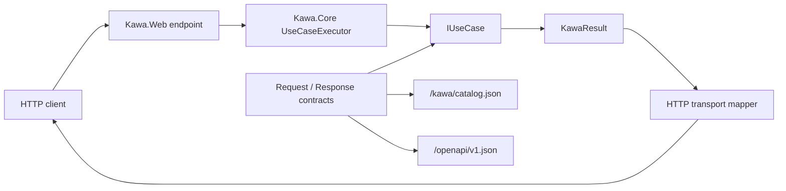
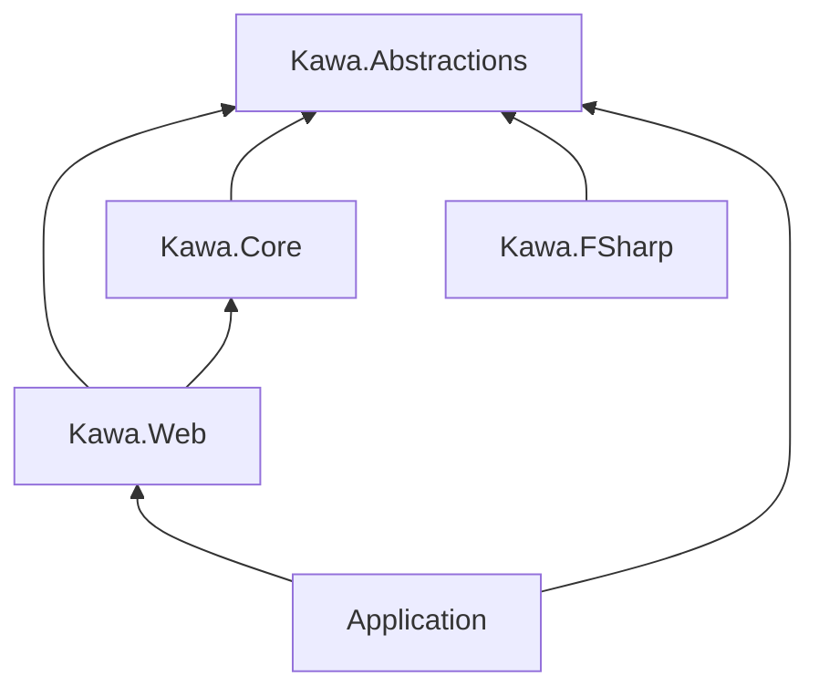
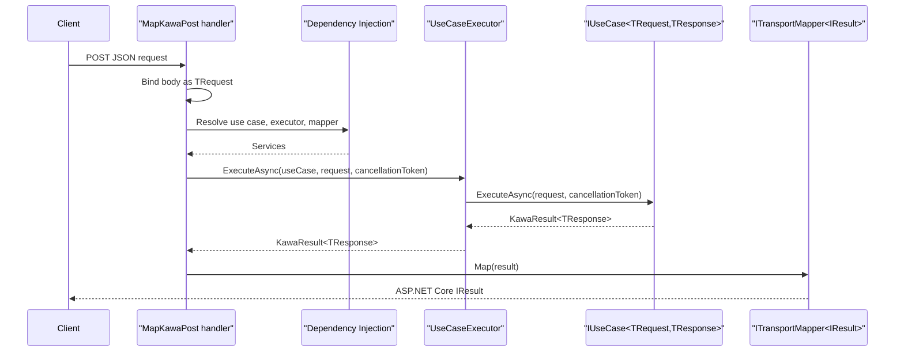
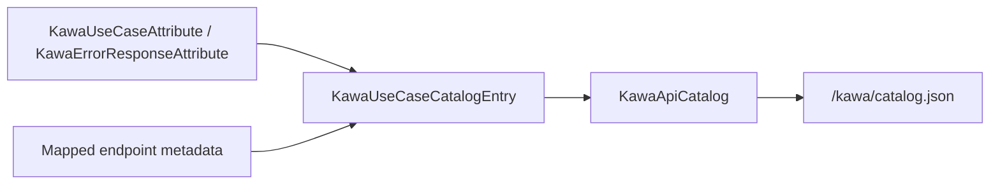

# Kawa 仕様書

## 概要

Kawa は、ASP.NET Core の上に薄いアプリケーション層として構築する contract-first の .NET Web フレームワークです。Kawa は、request/response contract と `IUseCase<TRequest,TResponse>` 実装をアプリケーションの中心に置きます。Hosting、dependency injection、routing、middleware、authentication、authorization、configuration、logging、基盤となる OpenAPI infrastructure は ASP.NET Core の責務です。

Kawa 0.5.0 は HTTP、MagicOnion RPC/StreamingHub、protobuf gRPC、CLI に対応します。Worker 統合は今後の対象です。



## Package Surface

`Kawa.Abstractions` は transport-independent な contract を含みます。主な型は `IUseCase<TRequest,TResponse>`、`KawaResult<T>`、`KawaError`、`KawaErrorKind`、catalog metadata、mapper abstractions です。

`Kawa.Core` は transport-independent な実行支援を含みます。現在の中心は `UseCaseExecutor` です。

`Kawa.Web` は ASP.NET Core Minimal API 統合、HTTP result mapping、API catalog endpoints、OpenAPI integration、Swagger/ReDoc UI helpers を含みます。

`Kawa.FSharp` は Kawa result values を扱うための F# helper を含みます。



## UseCase Contract

Kawa の use case は `IUseCase<TRequest,TResponse>` を実装します。

```csharp
public interface IUseCase<TRequest, TResponse>
{
    Task<KawaResult<TResponse>> ExecuteAsync(
        TRequest request,
        CancellationToken cancellationToken = default);
}
```

`TRequest` は入力 contract、`TResponse` は成功時の出力 contract です。Kawa は特定の DTO base class を要求しません。推奨規約は、request と response contract を use case の近くに置くことです。一般的には nested `Request` / `Response` record type として定義します。

`AddKawaUseCasesFromAssemblies` は、Kawa use case contract を実装する concrete、non-abstract、non-open-generic class を登録します。発見された use case は、実装している `IUseCase<TRequest,TResponse>` service として登録されます。

`MapKawaPost<TUseCase>` は、use case type がちょうど 1 つの request/response use case contract を表すことを要求します。`MapKawaPost<TRequest,TResponse>` は明示的な request/response contract type で endpoint を map し、request time に対応する `IUseCase<TRequest,TResponse>` を dependency injection から解決します。

## Result and Error Model

Use case は `KawaResult<TResponse>` を返します。

`KawaResult<T>.Success(value)` は成功 result を作成します。成功 result は `IsSuccess == true`、`IsFailure == false`、`Value` を持ち、`Error` を持ちません。

`KawaResult<T>.Failure(error)` は失敗 result を作成します。失敗 result は `IsSuccess == false`、`IsFailure == true`、`Error` を持ち、成功 value を持ちません。

`KawaError` は、`KawaErrorKind` と人間が読める message を持つ、予測可能な application error を表します。

現在の error kind は次の通りです。

| Kind | 意味 |
| --- | --- |
| `Validation` | request は構文上受け付けられたが、application validation rule に違反しています。 |
| `Unauthorized` | caller が authenticated ではありません。 |
| `Forbidden` | caller は authenticated ですが、その operation を実行できません。 |
| `NotFound` | 要求された resource または target が存在しません。 |
| `Conflict` | operation が現在の application state と衝突しています。 |
| `Unknown` | 他の既知 category に当てはまらない failure です。 |

## Web Integration

default の Kawa service は `AddKawa()` で登録します。

```csharp
builder.Services.AddKawa();
```

`AddKawa()` は `UseCaseExecutor`、HTTP success mapper、HTTP error mapper、HTTP transport mapper を登録します。

Use case は `AddKawaUseCasesFromAssemblies` で assembly から登録します。

```csharp
builder.Services.AddKawaUseCasesFromAssemblies(typeof(CreateUser).Assembly);
```

Kawa の OpenAPI convention は `AddKawaWeb()` で登録します。

```csharp
builder.Services.AddKawaWeb();
```

Use case type から POST endpoint を map します。

```csharp
app.MapKawaPost<CreateUser>("/users");
```

明示的な request/response contract type から POST endpoint を map します。

```csharp
app.MapKawaPost<CreateUser.Request, CreateUser.Response>("/users");
```

## HTTP Mapping

`MapKawaPost` は JSON request body を bind し、対応する use case を dependency injection から解決し、`UseCaseExecutor` で実行し、`KawaResult<TResponse>` を ASP.NET Core `IResult` に変換します。



成功 response は、response contract を JSON として serialize した `200 OK` に map されます。

失敗 response は次のように map されます。

| `KawaErrorKind` | HTTP response |
| --- | --- |
| `Validation` | `KawaError` JSON を持つ `400 Bad Request` |
| `Unauthorized` | `401 Unauthorized` |
| `Forbidden` | `403 Forbidden` |
| `NotFound` | `KawaError` JSON を持つ `404 Not Found` |
| `Conflict` | `KawaError` JSON を持つ `409 Conflict` |
| `Unknown` | `ProblemDetails` としての `500 Internal Server Error` |

## API Catalog

`MapKawaApiCatalog()` は Kawa API catalog endpoint を map します。default route は `/kawa/catalog.json` です。

catalog は、mapped Kawa use case の endpoint metadata から生成されます。use case metadata、request/response contract type name、error response metadata を含みます。

Transport-independent な use case metadata は `KawaUseCaseAttribute` で記述します。

```csharp
[KawaUseCase(
    "users.create",
    Summary = "Create user",
    Description = "Creates a user account.",
    Version = "v1",
    Tags = new[] { "Users" })]
```

想定される error response は `KawaErrorResponseAttribute` で記述します。

```csharp
[KawaErrorResponse(KawaErrorKind.Validation, Description = "Name is required.")]
```

catalog は transport-independent です。`Kawa.Web` はこれを HTTP で公開します。将来の adapter は、use case を HTTP に依存させずに同じ metadata を利用できます。



## OpenAPI, Swagger, and ReDoc

`MapKawaOpenApi()` は OpenAPI document endpoint を map します。default route は `/openapi/v1.json` です。

`AddKawaWeb()` は Kawa の OpenAPI behavior を設定します。`CreateUser.Request` や `CreateUser.Response` のような nested contract type は、full nested type name を元にした schema reference ID を使います。このとき `+` は `.` に置き換えます。これにより、generated client が別 use case の同名 nested contract を取り違えにくくなります。

Endpoint が `MapKawaPost<TUseCase>` で map される場合、Kawa は use case metadata を OpenAPI endpoint metadata に map します。

Contract assembly が assembly の隣に XML documentation file を出力している場合、Kawa は type と property の summary を OpenAPI schema description として使用します。Documented contract を定義する project では次を有効にしてください。

```xml
<GenerateDocumentationFile>true</GenerateDocumentationFile>
```

`MapKawaSwagger()` は Swagger UI を map します。default route は `/swagger` です。

`MapKawaReDoc()` は ReDoc を map します。default route は `/redoc` です。

Swagger と ReDoc は application middleware です。推奨 default は development でのみ map することです。Production で公開する場合は、application の明示的な判断として扱ってください。

## Multi-Language Boundary

Kawa は、public boundary が Kawa の C# friendly contract と互換である限り、複数の CLR language で実装された use case を扱えます。

このリポジトリには C#、F#、VB.NET sample が含まれます。Sample は ASP.NET Core host を C# に置きつつ、use case を language-specific project に置けることを示します。

Public request/response contract は、C#、ASP.NET Core serialization、OpenAPI generation、他の CLR language から自然に扱える単純な .NET type にしてください。

## Compatibility and Stability Notes

現在の stable behavior は、Kawa package の public API surface、use case execution contract、ここで記述した HTTP result mapping、API catalog shape、OpenAPI integration behavior です。

Worker、Controller、EF Core、認証・認可、検証フレームワークの統合は提供しません。

Kawa は ASP.NET Core の上に構築されます。そのため、host configuration、middleware ordering、authentication/authorization policy、production documentation exposure、logging、deployment settings は application author の責務です。


Unknownおよび未定義のエラー種類は、内部情報を公開しないため、HTTP 500のdetailを`An unexpected error occurred.`に固定します。元のエラーは変更しません。詳細が必要な場合、アプリケーションは変換前に安全なサーバーログへ記録してください。

RPCでもUnknownおよび未定義の種類をUnknownへ正規化し、status detailとkawa-error-binのmessageを同じ一般的な文言へ置換します。その他の既知の業務エラーは従来どおり公開されるため、機密情報を含めないでください。

## CLI統合

`Kawa.Cli`（0.5開発中）はCore、Abstractions、System.CommandLine、DI abstractionsに依存し、Kawa.Webを必要としません。`SetKawaAction(useCase, bindRequest)`でUnaryユースケースを直接結線します。`SetKawaAction<TRequest,TResponse>(services, bindRequest)`は呼び出しごとに非同期DIスコープを作成・破棄し、ユースケースと任意の`IKawaCliExitCodeMapper`、`IKawaCliTextFormatter<TResponse>`をスコープ内で解決します。

`InvokeKawaAsync(arguments, configuration, cancellationToken)`はSystem.CommandLineで解析・実行します。解析エラーは`configuration.Error`へ出力し、終了コード1を返します。エラー時のヘルプを標準出力へ混ぜません。明示的なhelp/versionはSystem.CommandLineの動作を維持します。呼び出し側およびコンソール操作によるキャンセルはExecutorへ伝播します。

成功値は`JsonSerializerDefaults.Web`のJSONとして標準出力へ書き込み、終了コード0を返します。失敗は標準エラーへJSONを書き込み、既定では終了コード1です。独自の終了コード変換は非ゼロを返す必要があります。登録済みテキストフォーマッターで対象レスポンスを人間向け表示へ切り替えられますが、未登録時はJSONです。予期しない例外とUnknown/未定義の種類の内部メッセージは秘匿します。既知の業務エラーのメッセージは公開されます。内部診断はアプリケーションが返却・例外送出前に記録してください。出力ストリームの所有権はアプリケーションに残ります。

## Aspire統合（0.5開発中）

`Kawa.Aspire`はサービス側の統合です。`AddKawaAspireDefaults(configuration?)`は`Kawa.*`と`MagicOnion.*`のActivity/MeterをOpenTelemetryへ登録し、HttpClientのサービス検出と`live`タグ付きの自己ヘルスチェックを追加します。`OTEL_EXPORTER_OTLP_ENDPOINT`の指定時だけOTLP出力を構成し、`OTEL_EXPORTER_OTLP_PROTOCOL`は`grpc`または`http/protobuf`を受け付けます。アプリが`MapKawaAspireHealthChecks()`を明示的に呼ぶと、`/health`（全チェック）と`/alive`（liveタグ付きチェック）を公開します。

Core ExecutorはBCLだけで`Kawa.Core`のActivity、および`kawa.usecase.calls`・`kawa.usecase.duration`を出力します。Unary、raw stream、Hubのライフサイクル・イベントを対象とし、タグにはユースケース型・操作・状態を含めます。入力・出力の本文や例外メッセージは記録しません。MagicOnion固有のSourceの収集には、そのトランスポートがSourceを出力する必要があります。Kawa ExecutorのSpanはそれとは独立して出力します。

`Kawa.Aspire.Hosting`はAppHost専用で、修正版Aspire.Hosting 13.6.5を要求します。`AddKawaMagicOnionProject(name, projectPath, targetPort?)`はHTTP/2のgrpcエンドポイントを定義し、既定では動的ポートを使います。`AddKawaCliProject(name, projectPath, arguments?)`は引数の区切りを保持します。`WithKawaMagicOnionReference(service)`はサービス検出と起動依存を追加します。返されたリソースには通常のAspireの環境変数・エンドポイント・依存関係の拡張を適用できます。登録時にサービスを起動することはありません。

## テンプレート・サンプル・スキーマ出力（0.5開発中）

`Kawa.Templates`は`kawa-cli`、`kawa-magiconion`、`kawa-grpc`、`kawa-aspire`を含みます。`KawaVersion`パラメーターの既定値は0.5.0です。生成プロジェクトはnet10.0を対象にNuGetパッケージを参照し、このリポジトリへの相対パスを含みません。MagicOnionとprotobufのサンプルは全raw stream方向に対応し、MagicOnionは型付きHubのグループ配信、protobufは既存スキーマの明示的アダプターも示します。AspireはMagicOnion/protobufサービスと、共通ServiceDefaultsを使う2つのCLIジョブを構成します。

`Kawa.Tool`は`kawa`コマンドを導入します。`kawa grpc export --schema <生成済みファイル> --output <出力先>`はビルド済みスキーマを明示的にコピーし、必要なら出力先ディレクトリを作ります。既存ファイルは`--force`なしでは上書きしません。通常のビルドは引き続きobj/だけへ生成します。実行手順と前提条件はsamples/README.mdを参照してください。テンプレートとサンプルは認証を省いたlocalhost用の例であり、本番環境のセキュリティ方針ではありません。

## 0.5.0 transport contracts

`Kawa.Abstractions` に `IServerStreamingUseCase`、`IClientStreamingUseCase`、`IDuplexStreamingUseCase`、`IStreamingHubUseCase` と通信方式に依存しないセッション・グループの契約を追加します。Core が各 Executor を提供します。ストリームは `IAsyncEnumerable` を用い、キャンセルを実行・列挙へ伝播します。HTTP POST は unary 専用です。

`Kawa.MagicOnion` と Analyzer パッケージは、属性付きユースケースからサービス契約・クライアント・サーバーアダプターを生成します。unary と 3 方向の raw stream に対応します。Hub は型付き receiver と明示的なグループ操作を利用します。状態管理・認可はアプリケーションが担当します。

`Kawa.Grpc` と `Kawa.Grpc.Generators` は `obj/` に protobuf スキーマとサーバーアダプターを生成します。フィールド番号は `[KawaProtoField(number)]` で明示し、安定して維持します。`Kawa.Grpc.ProtoAdapter` の `IGrpcProtoAdapter<TProto,TContract>` は既存スキーマの明示的変換を提供し、メンバーの自動対応付けは行いません。属性・登録の具体例は実行可能なサンプルを参照してください。

| エラー | HTTP | gRPC |
| --- | --- | --- |
| Cancelled | 499、本文なし | Cancelled |
| DeadlineExceeded | 504、本文なし | DeadlineExceeded |
| AlreadyExists | 409、KawaError | AlreadyExists |
| PreconditionFailed | 412、本文なし | FailedPrecondition |
| ResourceExhausted | 429、本文なし | ResourceExhausted |
| Unavailable | 503、本文なし | Unavailable |

既存の列挙値は Validation=0、NotFound=1、Unauthorized=2、Forbidden=3、Conflict=4、Unknown=5 を維持します。追加値は 6〜11 です。RPC の業務エラーは `kawa-error-bin` に格納します。Unknown・未定義のエラー詳細は秘匿します。

## 0.5.0 catalog extensions

`KawaUseCaseCatalogEntry.Transports` と `KawaApiCatalogUseCase.Transports` は `KawaApiCatalogTransport(Kind)` の省略可能なリストです。既存の位置引数コンストラクターと JSON フィールドは維持します。情報がなければ `transports` は出力しません。具体的ユースケースからの HTTP マッピングは `http` を付与します。要求・応答型のみのマッピングには具体的な Catalog 識別情報がありません。

稼働中の RPC/CLI を Catalog に含める場合は、空でない `Transports` を持つ `KawaUseCaseCatalogEntry` を DI に明示的に登録します。通信情報のない DI エントリーは HTTP にマップされた場合のみ掲載します。同じ実装型・要求型・応答型・名前・バージョンのエントリーは統合し、通信種別の重複を除去して整列します。属性だけから公開中と推測したり、ロード済みアセンブリを走査したりしません。

```csharp
builder.Services.AddSingleton(KawaUseCaseCatalog.FromUseCaseType(typeof(Send)) with
{
    Transports = [new("grpc") { Protocol = "protobuf", Service = "Chat", Operation = "Send" }],
});
```

ストリーミング契約では要素の要求型・応答型を指定して `KawaUseCaseCatalogEntry` を明示的に構築します。`FromUseCaseType` は従来どおり単一の unary 契約を受け付けます。通信情報には省略可能な `Protocol`、`Route`、`Method`、`Service`、`Operation`、`CommandPath`、`Hub` も含みます。RPC は `Protocol` に `magicOnion` または `protobuf` を指定します。HTTP は経路とメソッドを自動付与し、その他はサービス・操作、コマンド経路、Hub 名を明示します。ホストが実際に公開する通信方式のみ登録してください。

主開発は .NET 10 を維持し、CI で net10.0 テストを .NET 11 上でも実行します。.NET 11 との実際の互換性は専用 CI の結果で判断します。

## 0.5.0 generator and resolution guarantees

生成 RPC・Hub アダプターは `Kawa.Core.KawaUseCaseResolver` で属性付きの実装型を識別し、具体的な型の登録を優先します。従来のインターフェース登録も利用でき、対象の実装型に一致する最後の登録を選択します。同じ DTO を使う別の実装へ振り替えません。解決には要求・サービスのスコープを用います。スコープ付き依存関係がある場合や、同じ契約の全登録の列挙を避けたい場合は、具体的な型を scoped 登録してください。

各 MagicOnion サービスには `Add<Service>MagicOnionClient(services, factory)` を生成します。アプリケーションがクライアントの factory を渡し、チャネルの寿命を管理します。Kawa の登録コードは生成した共有インターフェースを使い、リフレクションを使いません。不正・曖昧な契約、無効・重複した生成名、不完全な Hub、未対応ペイロードは KAWA5001〜5004 のエラーになります。生成ファイル名には名前空間を反映し、別の名前空間に同名サービスを定義できます。

Hub セッション操作は送信・グループ変更の前と非同期完了後にキャンセルを確認します。送信済みイベントの取り消しはできません。MagicOnion のグループ API にキャンセル引数がないため、実行中のグループ操作は完了を待ってキャンセルを通知します。

protobuf の MSBuild タスクは参照解決後、protobuf コンパイル前に動きます。非公開に同梱した Roslyn の構文・型解析で、名前空間・別名、列挙型、入れ子、`byte[]`、配列・List/IList/ICollection/IEnumerable/IReadOnlyList/IReadOnlyCollection の反復フィールドに対応します。メッセージ型には public な引数なしコンストラクターと、番号を明示した public な書き込み可能フィールド、または public get/set/init プロパティが必要です。引数なしコンストラクターのない位置引数 record、nullable スカラー、辞書、decimal などの未対応型は、黙って省略せず KAWA5103 を返します。番号未指定は KAWA5102、重複・予約・不正な番号は KAWA5101 です。公開済みスキーマ間のフィールド番号互換性はアプリケーションが維持します。

HTTP Catalog の経路は最終 RouteEndpoint から読み、MapGroup の接頭辞を含みます。
