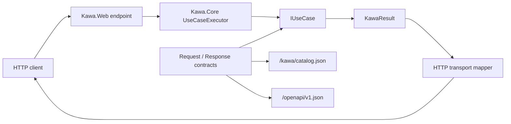
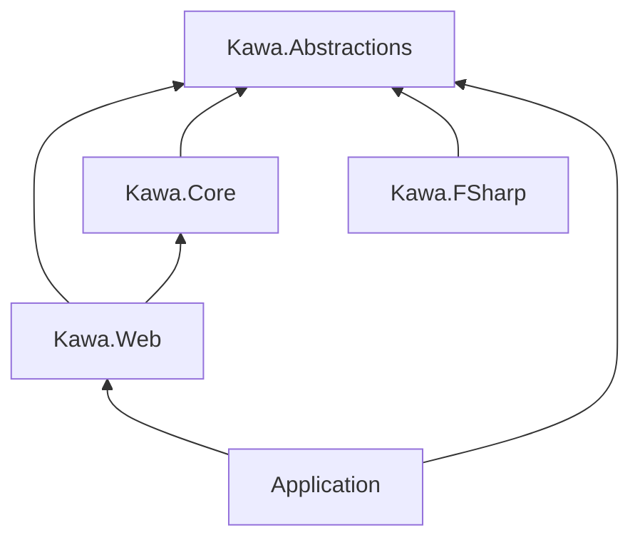
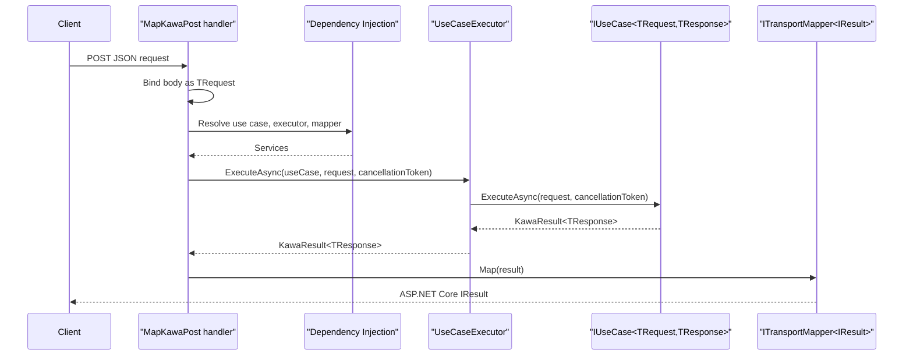
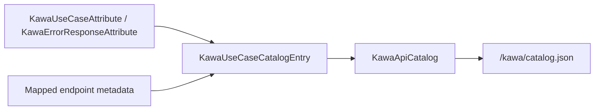

# Kawa Specification

## Overview

Kawa is a contract-first .NET web framework built as a thin application layer on ASP.NET Core. Kawa centers application flow on request/response contracts and `IUseCase<TRequest,TResponse>` implementations. ASP.NET Core remains responsible for hosting, dependency injection, routing, middleware, authentication, authorization, configuration, logging, and the underlying OpenAPI infrastructure.

Kawa 0.5.0 supports HTTP, MagicOnion RPC/StreamingHub, protobuf gRPC and CLI. Worker integration remains future work.



## Package Surface

`Kawa.Abstractions` contains the transport-independent contracts: `IUseCase<TRequest,TResponse>`, `KawaResult<T>`, `KawaError`, `KawaErrorKind`, catalog metadata, and mapper abstractions.

`Kawa.Core` contains transport-independent execution support, currently `UseCaseExecutor`.

`Kawa.Web` contains ASP.NET Core Minimal API integration, HTTP result mapping, API catalog endpoints, OpenAPI integration, and Swagger/ReDoc UI helpers.

`Kawa.FSharp` contains F# helpers for working with Kawa result values.



## UseCase Contract

A Kawa use case implements `IUseCase<TRequest,TResponse>`.

```csharp
public interface IUseCase<TRequest, TResponse>
{
    Task<KawaResult<TResponse>> ExecuteAsync(
        TRequest request,
        CancellationToken cancellationToken = default);
}
```

`TRequest` is the input contract and `TResponse` is the successful output contract. Kawa does not require a specific DTO base class. The recommended convention is to keep request and response contracts close to the use case, commonly as nested `Request` and `Response` record types.

`AddKawaUseCasesFromAssemblies` registers concrete, non-abstract, non-open-generic classes that implement a Kawa use case contract. Each discovered use case is registered as its implemented `IUseCase<TRequest,TResponse>` service.

`MapKawaPost<TUseCase>` requires the use case type to describe exactly one request/response use case contract. `MapKawaPost<TRequest,TResponse>` maps an endpoint by explicit request and response contract types and resolves the matching `IUseCase<TRequest,TResponse>` from dependency injection at request time.

## Result and Error Model

Use cases return `KawaResult<TResponse>`.

`KawaResult<T>.Success(value)` creates a successful result. Successful results have `IsSuccess == true`, `IsFailure == false`, a `Value`, and no `Error`.

`KawaResult<T>.Failure(error)` creates a failed result. Failed results have `IsSuccess == false`, `IsFailure == true`, an `Error`, and no successful value.

`KawaError` represents a predictable application error with a `KawaErrorKind` and a human-readable message.

The current error kinds are:

| Kind | Meaning |
| --- | --- |
| `Validation` | The request is syntactically accepted but violates application validation rules. |
| `Unauthorized` | The caller is not authenticated. |
| `Forbidden` | The caller is authenticated but not allowed to perform the operation. |
| `NotFound` | The requested resource or target does not exist. |
| `Conflict` | The operation conflicts with current application state. |
| `Unknown` | The failure does not fit another known category. |

## Web Integration

Register the default Kawa services with `AddKawa()`:

```csharp
builder.Services.AddKawa();
```

`AddKawa()` registers `UseCaseExecutor`, the HTTP success mapper, the HTTP error mapper, and the HTTP transport mapper.

Register use cases from assemblies with `AddKawaUseCasesFromAssemblies`:

```csharp
builder.Services.AddKawaUseCasesFromAssemblies(typeof(CreateUser).Assembly);
```

Register Kawa's OpenAPI conventions with `AddKawaWeb()`:

```csharp
builder.Services.AddKawaWeb();
```

Map a POST endpoint from a use case type:

```csharp
app.MapKawaPost<CreateUser>("/users");
```

Map a POST endpoint from explicit request and response contract types:

```csharp
app.MapKawaPost<CreateUser.Request, CreateUser.Response>("/users");
```

## HTTP Mapping

`MapKawaPost` binds the JSON request body, resolves the matching use case from dependency injection, executes it through `UseCaseExecutor`, and maps the `KawaResult<TResponse>` to an ASP.NET Core `IResult`.



Successful responses map to `200 OK` with the response contract serialized as JSON.

Failure responses map as follows:

| `KawaErrorKind` | HTTP response |
| --- | --- |
| `Validation` | `400 Bad Request` with `KawaError` JSON |
| `Unauthorized` | `401 Unauthorized` |
| `Forbidden` | `403 Forbidden` |
| `NotFound` | `404 Not Found` with `KawaError` JSON |
| `Conflict` | `409 Conflict` with `KawaError` JSON |
| `Unknown` | `500 Internal Server Error` as `ProblemDetails` |

## API Catalog

`MapKawaApiCatalog()` maps the Kawa API catalog endpoint. The default route is `/kawa/catalog.json`.

The catalog is generated from endpoint metadata for mapped Kawa use cases. It includes use case metadata, request and response contract type names, and error response metadata.

Use `KawaUseCaseAttribute` to describe transport-independent use case metadata:

```csharp
[KawaUseCase(
    "users.create",
    Summary = "Create user",
    Description = "Creates a user account.",
    Version = "v1",
    Tags = new[] { "Users" })]
```

Use `KawaErrorResponseAttribute` to document expected error responses:

```csharp
[KawaErrorResponse(KawaErrorKind.Validation, Description = "Name is required.")]
```

The catalog is transport-independent. `Kawa.Web` exposes it over HTTP, and future adapters can use the same metadata without making the use case depend on HTTP.



## OpenAPI, Swagger, and ReDoc

`MapKawaOpenApi()` maps the OpenAPI document endpoint. The default route is `/openapi/v1.json`.

`AddKawaWeb()` configures Kawa OpenAPI behavior. Nested contract types such as `CreateUser.Request` and `CreateUser.Response` use schema reference IDs based on their full nested type names, with `+` replaced by `.`, so generated clients do not confuse same-named nested contracts from different use cases.

Kawa maps use case metadata to OpenAPI endpoint metadata when endpoints are mapped through `MapKawaPost<TUseCase>`.

When a contract assembly emits an XML documentation file next to its assembly, Kawa uses type and property summaries as OpenAPI schema descriptions. Projects that define documented contracts should enable:

```xml
<GenerateDocumentationFile>true</GenerateDocumentationFile>
```

`MapKawaSwagger()` maps Swagger UI. The default route is `/swagger`.

`MapKawaReDoc()` maps ReDoc. The default route is `/redoc`.

Swagger and ReDoc are application middleware. The recommended default is to map them only in development. Production exposure should be an explicit application decision.

## Multi-Language Boundary

Kawa supports use cases implemented from multiple CLR languages as long as the public boundary remains compatible with Kawa's C# friendly contracts.

The repository includes C#, F#, and VB.NET samples. The samples keep the ASP.NET Core host in C# while allowing use cases to live in language-specific projects.

Public request and response contracts should remain simple .NET types that are natural for C#, ASP.NET Core serialization, OpenAPI generation, and other CLR languages to consume.

## Compatibility and Stability Notes

The current stable behavior is the public API surface in the Kawa packages, the use case execution contract, the documented HTTP result mapping, the API catalog shape, and the OpenAPI integration behavior described above.

Kawa does not provide Worker, Controller, EF Core, authentication, authorization, or validation framework integrations.

Because Kawa builds on ASP.NET Core, application authors remain responsible for host configuration, middleware ordering, authentication and authorization policies, production documentation exposure, logging, and deployment settings.


Unknown and undefined error kinds return HTTP 500 with the fixed detail `An unexpected error occurred.` to avoid exposing internal information. The original error is unchanged. Applications that need diagnostics should log details securely before transport mapping.

RPC adapters also normalize Unknown and undefined kinds to Unknown, replacing both status detail and the kawa-error-bin message with the same generic text. Other known application errors remain public and must not contain secrets.

## CLI Integration

`Kawa.Cli` (0.5.0) depends on Core, Abstractions, System.CommandLine, and DI abstractions; it does not require Kawa.Web. `SetKawaAction(useCase, bindRequest)` binds an explicit unary use case. `SetKawaAction<TRequest,TResponse>(services, bindRequest)` creates and disposes an async DI scope per invocation and resolves the use case, optional `IKawaCliExitCodeMapper`, and optional `IKawaCliTextFormatter<TResponse>` in that scope.

`InvokeKawaAsync(arguments, configuration, cancellationToken)` uses System.CommandLine parsing and invocation. Parse errors go to `configuration.Error` with exit code 1 and no help text on stdout. Explicit help and version actions retain System.CommandLine behavior. Cancellation from invocation, including its console cancellation handling, reaches the executor.

Successful values use `JsonSerializerDefaults.Web` JSON on stdout and exit code 0. Failures use JSON on stderr and exit code 1 by default. A custom exit code mapper must return nonzero. A registered text formatter opts its response type into human-readable output; without a formatter JSON remains the default. Unexpected exceptions and Unknown/undefined error messages are redacted. Known application error messages are public. Applications must log private diagnostics themselves before returning or throwing. Output writers remain owned by the application.

## Aspire integration (0.5.0)

`Kawa.Aspire` is service-side only. `AddKawaAspireDefaults(configuration?)` subscribes OpenTelemetry to `Kawa.*` and `MagicOnion.*` activity/meter names, registers service discovery for HttpClient, and adds the self health check tagged `live`. OTLP export is configured only when `OTEL_EXPORTER_OTLP_ENDPOINT` is present; `OTEL_EXPORTER_OTLP_PROTOCOL` accepts `grpc` or `http/protobuf`. An application explicitly calls `MapKawaAspireHealthChecks()` to expose `/health` (all checks) and `/alive` (checks tagged live).

Core executors emit BCL-only `Kawa.Core` activities and `kawa.usecase.calls` / `kawa.usecase.duration` measurements. Unary, raw streams, and hub lifecycle/event operations are covered. Tags contain use-case type, operation and status; request/response payloads and exception messages are not recorded. Collecting MagicOnion's own source names depends on that transport emitting them; the Kawa executor spans are emitted independently.

`Kawa.Aspire.Hosting` is AppHost-only and requires patched Aspire.Hosting 13.6.5. `AddKawaMagicOnionProject(name, projectPath, targetPort?)` defines a named HTTP/2 grpc endpoint (dynamic target port by default). `AddKawaCliProject(name, projectPath, arguments?)` preserves individual argument tokens. `WithKawaMagicOnionReference(service)` adds discovery and startup dependency. Resource builders retain Aspire's ordinary environment, endpoint and dependency extension methods. Registration does not itself run services.

## Templates, samples and schema export (0.5.0)

`Kawa.Templates` contains four short names: `kawa-cli`, `kawa-magiconion`, `kawa-grpc`, `kawa-aspire`. The `KawaVersion` parameter defaults to 0.5.0. Generated projects target net10.0, reference NuGet packages and contain no paths back to this repository. MagicOnion/protobuf samples demonstrate all raw stream directions; MagicOnion also demonstrates typed hub group broadcast, and protobuf demonstrates explicit legacy schema adapters. The Aspire topology includes MagicOnion/protobuf services and two CLI jobs sharing ServiceDefaults.

`Kawa.Tool` installs the `kawa` command. `kawa grpc export --schema <generated-file> --output <destination>` copies the already built schema explicitly, creates the destination directory if needed, and refuses to overwrite an existing file unless `--force` is present. Normal builds continue to generate only under obj/. See samples/README.md for runnable commands and local prerequisites. Templates and samples are unauthenticated localhost demonstrations, not a deployment security policy.

## 0.5.0 transport contracts

`Kawa.Abstractions` adds `IServerStreamingUseCase`, `IClientStreamingUseCase`, `IDuplexStreamingUseCase`, `IStreamingHubUseCase` and transport-neutral hub session/group interfaces. Core provides the corresponding executors. Streams use `IAsyncEnumerable`; cancellation flows to execution and enumeration. HTTP POST remains unary.

`Kawa.MagicOnion` and its analyzer package generate service contracts, clients and server adapters from marked use cases. Raw RPC supports unary and all three stream directions. Hub adapters use typed receivers and explicit group operations; application state and authorization remain application responsibilities.

`Kawa.Grpc` and `Kawa.Grpc.Generators` generate protobuf schemas under `obj/` and server adapters. Contract fields require explicit stable `[KawaProtoField(number)]` numbers. `Kawa.Grpc.ProtoAdapter` provides `IGrpcProtoAdapter<TProto,TContract>` for explicit conversion of existing schemas. No inferred member mapping is performed. See the runnable samples for complete attribute and service registration examples.

| Error | HTTP | gRPC |
| --- | --- | --- |
| Cancelled | 499, empty | Cancelled |
| DeadlineExceeded | 504, empty | DeadlineExceeded |
| AlreadyExists | 409, KawaError | AlreadyExists |
| PreconditionFailed | 412, empty | FailedPrecondition |
| ResourceExhausted | 429, empty | ResourceExhausted |
| Unavailable | 503, empty | Unavailable |

Existing numeric enum values remain Validation=0, NotFound=1, Unauthorized=2, Forbidden=3, Conflict=4, Unknown=5. New values occupy 6–11. RPC application failures carry `kawa-error-bin` metadata; Unknown/undefined errors are redacted.

## 0.5.0 catalog extensions

`KawaUseCaseCatalogEntry.Transports` and `KawaApiCatalogUseCase.Transports` are optional lists of `KawaApiCatalogTransport(Kind)`. Existing positional constructors and JSON fields remain. The `transports` field is omitted when absent. HTTP mappings from concrete use cases attach `http`; explicit request/response mappings have no concrete catalog identity.

Applications may explicitly register `KawaUseCaseCatalogEntry` instances with nonempty `Transports` in DI to include active RPC/CLI bindings in `MapKawaApiCatalog`. Entries without transport metadata are still included only when mapped to HTTP. The catalog merges bindings for the same use-case type, request/response types, name and version, deduplicating and sorting transport kinds. It does not infer active bindings from attributes or scan loaded assemblies.

```csharp
builder.Services.AddSingleton(KawaUseCaseCatalog.FromUseCaseType(typeof(Send)) with
{
    Transports = [new("grpc") { Protocol = "protobuf", Service = "Chat", Operation = "Send" }],
});
```

For streaming contracts, construct `KawaUseCaseCatalogEntry` explicitly with the element request/response types. `FromUseCaseType` continues to accept exactly one unary contract. Transport descriptors also expose optional `Protocol`, `Route`, `Method`, `Service`, `Operation`, `CommandPath` and `Hub` properties. RPC registrations identify `magicOnion` or `protobuf` in `Protocol`. HTTP mappings populate route/method; non-HTTP bindings supply their own service/operation, command path or hub name. Applications must register only bindings actually exposed by their host.

Development stays on .NET 10; CI additionally executes the net10.0 tests on .NET 11. Actual .NET 11 compatibility is established by that CI job, not by a local .NET 10 build.

## 0.5.0 generator and resolution guarantees

Generated RPC and hub adapters resolve the annotated implementation through `Kawa.Core.KawaUseCaseResolver`, preferring a concrete registration. Existing interface registrations remain supported: the last registration matching that implementation is selected; a different implementation sharing the same DTO pair is never substituted. Resolution uses the request/service scope. Prefer concrete scoped registrations when handlers depend on scoped services or when enumerating all registrations of a contract is undesirable.

Each MagicOnion service generates a typed `Add<Service>MagicOnionClient(services, factory)` extension. The application supplies its client factory and owns the channel lifetime; Kawa registers the generated shared interface without reflection. Invalid/ambiguous contracts, invalid or duplicate generated names, incomplete hub declarations, and unsupported payload kinds produce KAWA5001–5004 errors. Namespaced source hints prevent collisions between equal service names in different namespaces.

Hub session operations observe cancellation before sending or changing membership, and after asynchronous completion. Already issued events cannot be recalled; underlying MagicOnion group APIs do not expose cancellation, so an in-flight group operation is awaited before cancellation is reported.

The protobuf MSBuild task runs after references resolve and before protobuf compilation. It uses a privately bundled Roslyn parser/semantic model, supporting namespace-qualified contracts, aliases, enum values, nested messages, `byte[]`, and arrays/List/IList/ICollection/IEnumerable/IReadOnlyList/IReadOnlyCollection repeated fields. Message types need a public parameterless constructor and public writable fields or public get/set/init properties, each numbered explicitly. Positional records without a parameterless constructor, nullable scalar wrappers, dictionaries, decimal and other unsupported types fail with a KAWA5103 diagnostic rather than being omitted. Missing numbers use KAWA5102; duplicate/reserved/invalid numbers use KAWA5101. Field-number compatibility across published schema versions remains the application's responsibility.

HTTP Catalog routes include MapGroup prefixes from the final route endpoint.
